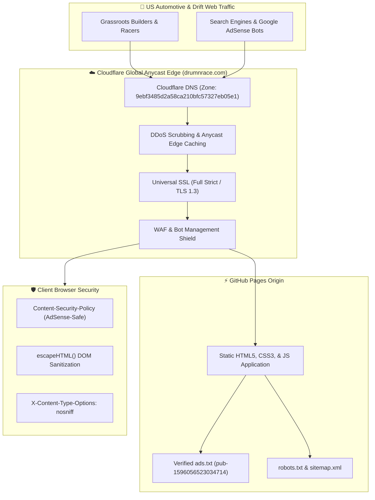

# 🇺🇸 DRUM 'N' RACE USA // Grassroots Drift Culture, Junkyard Swaps & Car Modifications

```text
 ██████╗ ██████╗ ██╗   ██╗███╗   ███╗    ███╗   ██╗    ██████╗  █████╗  ██████╗███████╗
 ██╔══██╗██╔══██╗██║   ██║████╗ ████║    ████╗  ██║    ██╔══██╗██╔══██╗██╔════╝██╔════╝
 ██║  ██║██████╔╝██║   ██║██╔████╔██║    ██╔██╗ ██║    ██████╔╝███████║██║     █████╗  
 ██║  ██║██╔══██╗██║   ██║██║╚██╔╝██║    ██║╚██╗██║    ██╔══██╗██╔══██║██║     ██╔══╝  
 ██████╔╝██║  ██║╚██████╔╝██║ ╚═╝ ██║    ██║ ╚████║    ██║  ██║██║  ██║╚██████╗███████╗
 ╚═════╝ ╚═╝  ╚═╝ ╚═════╝ ╚═╝     ╚═╝    ╚═╝  ╚═══╝    ╚═╝  ╚═╝╚═╝  ╚═╝ ╚═════╝╚══════╝
```

> **[OFFICIAL PRODUCTION REPOSITORY]**  
> *America's premier homebrew drift racing portal. Junkyard LS/turbo swaps, grassroots US track radar, angle kit geometry, and local aftermarket parts exchange.*  
> Engineered by **Efrain Rivas** — Senior Enterprise Infrastructure Architect.

---

## ⚡ Live Telemetry & Badges

[](https://drumnrace.com)
[](https://digdast.github.io/drumnrace-website/)
[](https://drumnrace.com)
[](https://dash.cloudflare.com)
[](https://drumnrace.com)
[](https://drumnrace.com/ads.txt)
[](https://tailwindcss.com)

---

## 🌟 Core Platform Highlights

1. **US Grassroots Drift Venue Radar**:
   - Filterable track radar covering **East Coast** (Carolina Motorsports Park, Spirit Peaks Raceway), **Midwest** (Kil-Kare Raceway Xenia, USAIR Motorsports Wisconsin), **South** (Orlando Speed World, Houston Police Academy), and **West Coast** (Apple Valley Speedway, Grange Motor Circuit).
2. **High-CPC Junkyard Swap & Car Modification Blueprints**:
   - Comprehensive tuning blueprints for budget American builds:
     - **Junkyard 5.3L Vortec LM7 LS Swap**: Wiring harness repins, standalone Terminator X ECU, LS6 camshaft, and T56 transmission adaptations.
     - **Nissan 350Z Angle & Cooling Suite**: FDF Mantis / SLR angle kits, ISR dual rear calipers, CSF triple-pass radiators, and baffled oil pans.
     - **BMW E46 Grassroots Missile Blueprint**: M54B30 turbo manifolds, weld-in rear subframe reinforcement plates, and SLR Mini angle geometry.
3. **Interactive Budget Drift Modification Calculator**:
   - Real-time build estimator categorized by entry tier: **Stage 1 "Street Missile"** (\$2,500), **Stage 2 "Pro-Am Contender"** (\$6,500), and **Stage 3 "Full Competition Comp"** (\$15,000+).
4. **Community Swap Meet & Parts Exchange**:
   - Dynamic swap board for grassroots drivers to list lock kits, welded differentials, and turbo manifolds with real-time DOM XSS escaping.
5. **Google AdSense Revenue Engine**:
   - High CPC automotive performance keywords, responsive ad slots, and verified authorized `ads.txt` integration (`pub-1596056523034714`).

---

## 🏗️ High-Availability Edge Architecture



---

## 🛡️ Security Hardening & Compliance

- **AdSense-Compliant CSP**: Authorizes Google AdSense ad frames and scripts while blocking unauthorized external script injections and malvertising.
- **MIME & Referrer Policies**: `X-Content-Type-Options: nosniff` and `Referrer-Policy: strict-origin-when-cross-origin`.
- **DOM Sanitization**: HTML entity escaping (`escapeHTML`) across all user-submitted listings.
- **GDPR / CCPA Policy**: Integrated privacy policy and cookie modal for full Google Publisher compliance.

---

## 📂 Repository Topology

```text
drumnrace-website/
├── index.html        # High-performance US drift single-page app
├── ads.txt           # Google AdSense publisher validation (pub-1596056523034714)
├── robots.txt        # Universal search engine indexing directive
├── sitemap.xml       # Canonical XML sitemap for SEO discovery
├── CNAME             # GitHub Pages custom domain binding (drumnrace.com)
├── static/           # Vector branding assets, SVGs, and logos
└── README.md         # Architecture, security & telemetry documentation
```

---

## ⚖️ License & Attribution

Designed and maintained by **Efrain Rivas**.  
All rights reserved © 2026 **DrumNRace.com**.
